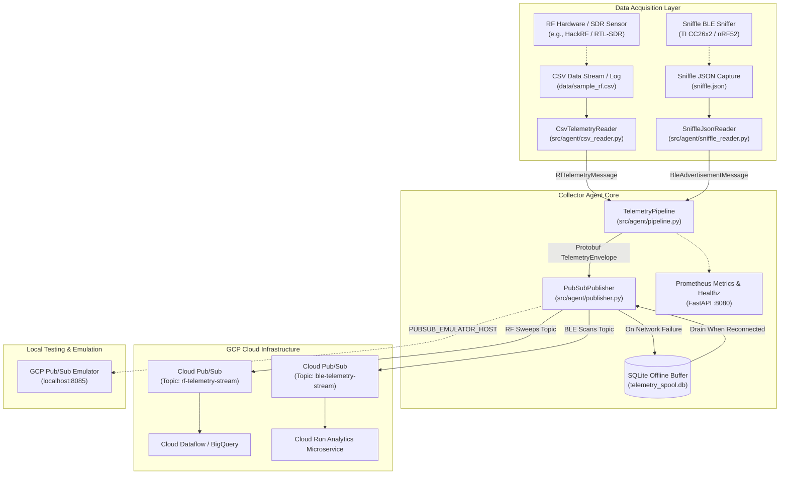
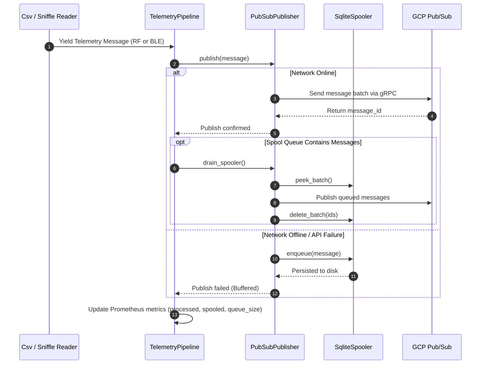
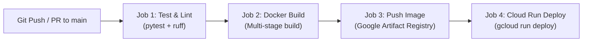

# GCP RF Telemetry Collector Agent

[](.github/workflows/deploy.yml)
[](https://www.python.org/)
[](LICENSE)

An IoT/Edge data collector agent designed to capture Radio Frequency (RF) spectral sweep telemetry and Bluetooth Low Energy (BLE) advertisement scans from local sensors, SDR hardware (such as HackRF), or simulated captures (CSV logs, Sniffle Wireshark JSON). Telemetry is serialized using Protocol Buffers (`protobuf`) with polymorphic envelope packaging and streamed reliably to Google Cloud Platform (GCP) Cloud Pub/Sub and Cloud Run services with zero data loss during network disruptions.

---

## Architecture & System Design

### 1. End-to-End System Topology



### 2. Telemetry Processing & Offline Resilience Workflow

The agent guarantees resilience across unreliable edge network connections through persistent SQLite spooling and automated queue draining:



### 3. CI/CD Deployment Pipeline



---

## Key Features

- **Dual RF & BLE Telemetry Drivers:** Ingests wideband spectral sweep CSV logs (`CsvTelemetryReader`) and Sniffle BLE advertisement captures (`SniffleJsonReader`).
- **Low-Memory Streaming Parser:** Reads multi-gigabyte Sniffle Wireshark JSON packet dumps in constant O(1) memory without buffer exhaustion.
- **Protocol Buffers Polymorphism:** Compact encoding of `RfTelemetryMessage` and `BleAdvertisementMessage` inside a unified `TelemetryEnvelope` (`oneof payload`).
- **Signal Quality & Noise Filtering:** Configurable CRC checksum error filtering and minimum RSSI threshold (`--min-rssi`) for BLE scans.
- **Zero Data Loss Guarantee:** Persistent SQLite disk queue (`telemetry_spool.db`) buffers readings during network dropouts and automatically drains when connectivity resumes.
- **Flexible GCP Transports:** Supports direct Google Cloud Pub/Sub, dedicated BLE topics (`--ble-topic-id`), local Pub/Sub emulator (`PUBSUB_EMULATOR_HOST`), and pure offline mock mode.
- **Observability Built-in:** Lightweight FastAPI server providing `/healthz` for Kubernetes/Cloud Run health probes and `/metrics` for Prometheus scraping.

---

## Protobuf Telemetry Schema

The schemas are defined in [`proto/telemetry.proto`](proto/telemetry.proto):

### 1. Spectral Sweep (`RfTelemetryMessage`)

| Field Number | Field Name | Type | Description |
|---|---|---|---|
| `1` | `device_id` | `string` | Unique identifier for sensor/collector node |
| `2` | `timestamp_iso` | `string` | ISO 8601 UTC timestamp (`YYYY-MM-DDTHH:MM:SSZ`) |
| `3` | `timestamp_epoch_ms` | `int64` | Milliseconds since Unix epoch |
| `4` | `hz_low` | `double` | Start frequency of sweep range in Hertz |
| `5` | `hz_high` | `double` | Stop frequency of sweep range in Hertz |
| `6` | `hz_bin_width` | `double` | Step width per frequency bin in Hertz |
| `7` | `num_samples` | `int32` | Total FFT samples collected |
| `8` | `db_bins` | `repeated float` | Power spectral density measurements in dB per bin |
| `9` | `metadata` | `map<string, string>` | Extensible key-value metadata (gain, antenna, etc.) |

### 2. BLE Advertisement (`BleAdvertisementMessage`)

| Field Number | Field Name | Type | Description |
|---|---|---|---|
| `1` | `device_id` | `string` | Sniffer node identifier |
| `2` | `timestamp_iso` | `string` | ISO 8601 UTC timestamp |
| `3` | `timestamp_epoch_ms` | `int64` | Milliseconds since epoch |
| `4` | `channel` | `int32` | BLE RF channel index (e.g., 0-39, advertising 37, 38, 39) |
| `5` | `signal_dbm` | `int32` | Received Signal Strength Indicator (RSSI in dBm) |
| `6` | `access_address` | `string` | BLE access address (hex string) |
| `7` | `pdu_type` | `string` | Advertising PDU type (`ADV_IND`, `SCAN_REQ`, `SCAN_RSP`, etc.) |
| `8` | `advertiser_mac` | `string` | Advertiser MAC address |
| `9` | `scanner_mac` | `string` | Scanner MAC address (for scan requests) |
| `10` | `device_name` | `string` | Extracted device name from EIR/AD entries |
| `11` | `company_id` | `string` | Manufacturer company ID (e.g., `0x004c` for Apple) |
| `12` | `adv_data_raw` | `bytes` | Raw advertisement payload / service data bytes |
| `13` | `crc_valid` | `bool` | True if packet CRC checksum is valid |
| `14` | `metadata` | `map<string, string>` | Extensible packet metadata |

---

## Project Structure

```
gcp_rf_telemetry/
├── .github/
│   └── workflows/
│       └── deploy.yml              # CI/CD: Test, build, push, deploy to Cloud Run
├── conductor/                      # Spec-Driven Development tracks & blueprints
├── data/
│   └── sample_rf.csv               # Default sample RF sweep dataset
├── proto/
│   └── telemetry.proto             # Protobuf schema definition
├── scripts/
│   └── compile_proto.py            # Protobuf-to-Python compilation script
├── src/
│   └── agent/
│       ├── __init__.py
│       ├── cli.py                  # CLI entrypoint & argument parsing
│       ├── csv_reader.py           # Spectral CSV ingestion & parsing
│       ├── pipeline.py             # Telemetry orchestration loop
│       ├── publisher.py            # GCP Pub/Sub & Mock transport
│       ├── server.py               # FastAPI /healthz & Prometheus /metrics
│       ├── sniffle_reader.py       # Streaming Sniffle BLE JSON parser
│       ├── spooler.py              # SQLite offline buffer queue
│       └── proto/
│           ├── __init__.py
│           └── telemetry_pb2.py    # Auto-generated Protobuf Python classes
├── tests/
│   ├── fixtures/
│   │   ├── sample_rf.csv           # Test CSV fixture
│   │   └── sample_sniffle.json     # Test Sniffle JSON fixture
│   ├── test_cli.py                 # CLI integration tests
│   ├── test_cli_sniffle.py         # CLI Sniffle tests
│   ├── test_csv_reader.py          # CSV parser tests
│   ├── test_pipeline.py            # Spectral pipeline tests
│   ├── test_pipeline_ble.py        # BLE pipeline & spooler tests
│   ├── test_proto.py               # RF Protobuf serialization tests
│   ├── test_proto_ble.py           # BLE Protobuf & envelope tests
│   ├── test_publisher.py           # Pub/Sub publisher tests
│   ├── test_server.py              # Observability endpoint tests
│   ├── test_sniffle_reader.py      # Sniffle BLE reader tests
│   └── test_spooler.py             # SQLite queue tests
├── docker-compose.yml              # Agent + Pub/Sub emulator orchestration
├── Dockerfile                      # Multi-stage production container image
├── pyproject.toml                  # Dependencies, build tools, & test configs
└── README.md                       # Project documentation
```

---

## Getting Started

### Prerequisites

- Python 3.11+
- Docker and Docker Compose (optional, for containerized execution)
- Google Cloud SDK (`gcloud`) if deploying or running against live GCP resources

### Installation

1. **Clone the repository:**
   ```bash
   git clone https://github.com/self/gcp_rf_telemetry.git
   cd gcp_rf_telemetry
   ```

2. **Create and activate a virtual environment:**
   ```bash
   python3 -m venv .venv
   source .venv/bin/activate
   ```

3. **Install dependencies:**
   ```bash
   pip install --upgrade pip setuptools wheel
   pip install -e ".[dev]" grpcio-tools
   ```

4. **Compile the Protobuf schema:**
   ```bash
   python scripts/compile_proto.py
   ```

---

## Running the Agent

### 1. Ingesting Spectral Sweep CSV
```bash
# Dry run
python -m agent.cli --csv-file data/sample_rf.csv --dry-run

# Mock mode with local spooler & metrics server on port 8080
python -m agent.cli --csv-file data/sample_rf.csv --mock-mode --port 8080
```

### 2. Ingesting Sniffle BLE Advertisement Scans
```bash
# Dry run with minimum RSSI filter (-60 dBm)
python -m agent.cli --sniffle-json sniffle.json --min-rssi -60 --dry-run

# Mock mode replaying packet time deltas in real-time
python -m agent.cli --sniffle-json sniffle.json --realtime --mock-mode
```

### 3. Live Google Cloud Pub/Sub Streaming
Stream real-time telemetry to GCP Pub/Sub topics:
```bash
gcloud auth application-default login

python -m agent.cli \
  --project-id my-gcp-project \
  --topic-id rf-telemetry-stream \
  --ble-topic-id ble-telemetry-stream \
  --sniffle-json sniffle.json \
  --min-rssi -75
```

---

## Docker & Local Emulation

### Run with Docker Compose (Agent + Pub/Sub Emulator)
```bash
docker compose up --build
```
This boots:
- **`pubsub-emulator`** listening on `0.0.0.0:8085`
- **`telemetry-agent`** streaming data to the emulator while exposing `/healthz` and `/metrics` on `http://localhost:8080`

### Build and Run Standalone Docker Image
```bash
docker build -t gcp-rf-telemetry-agent:latest .

docker run -p 8080:8080 \
  -e GCP_PROJECT_ID=gcp-rf-telemetry \
  -e PUBSUB_TOPIC_ID=rf-telemetry-stream \
  gcp-rf-telemetry-agent:latest
```

---

## Configuration Reference

### Command Line Arguments

| Flag | Default | Description |
|---|---|---|
| `--csv-file` | `data/sample_rf.csv` | Path to RF sweep CSV data file |
| `--sniffle-json` | `None` | Path to Sniffle BLE JSON capture file |
| `--min-rssi` | `None` | Minimum RSSI threshold in dBm for BLE packets |
| `--realtime` | `False` | Replay BLE capture using packet time-delta timestamps |
| `--project-id` | `gcp-rf-telemetry` | GCP Project ID (reads `GCP_PROJECT_ID` env) |
| `--topic-id` | `rf-telemetry-stream` | Primary GCP Pub/Sub Topic ID (reads `PUBSUB_TOPIC_ID` env) |
| `--ble-topic-id` | `None` | Dedicated GCP Pub/Sub Topic ID for BLE scans |
| `--spool-db` | `telemetry_spool.db` | Path to SQLite buffer database |
| `--mock-mode` | `True` | Run publisher in mock mode without GCP calls |
| `--dry-run` | `False` | Parse data and print output without publishing |
| `--loop-csv` | `False` | Continuously repeat file playback |
| `--interval-sec` | `1.0` | Pause duration between emitted telemetry readings |
| `--port` | `8080` | Port for `/healthz` and `/metrics` HTTP server |

### Environment Variables

| Variable | Description |
|---|---|
| `GCP_PROJECT_ID` | GCP Project ID |
| `PUBSUB_TOPIC_ID` | Primary Pub/Sub Topic Name |
| `BLE_PUBSUB_TOPIC_ID` | Dedicated Pub/Sub Topic Name for BLE scans |
| `PUBSUB_EMULATOR_HOST` | Host and port of Pub/Sub Emulator (`localhost:8085`) |
| `GOOGLE_APPLICATION_CREDENTIALS` | Path to GCP Service Account JSON key |

---

## Observability & Health Probes

- **`GET /healthz`**: Returns `200 OK` JSON response (`{"status": "ok", "service": "gcp-rf-telemetry-agent"}`).
- **`GET /metrics`**: Standard Prometheus text format endpoint tracking:
  - `telemetry_messages_processed_total`: Total count of telemetry records processed.
  - `telemetry_messages_spooled_total`: Total count of messages written to disk during network interruptions.
  - `telemetry_spool_queue_size`: Gauge representing pending items in `telemetry_spool.db`.
  - `ble_packets_processed_total`: Total count of BLE frames processed.
  - `ble_packets_crc_errors_total`: Total count of dropped corrupt BLE packets.

---

## Testing & Quality Assurance

Run the test suite with code coverage:
```bash
pytest --cov=agent --cov-report=term-missing
```

Run code formatting and linting checks:
```bash
ruff check .
```

---

## CI/CD Deployment

The GitHub Actions workflow (`.github/workflows/deploy.yml`) automates:
1. **Verification:** Runs `ruff` linting and `pytest` test suite with coverage enforcement.
2. **Build:** Compiles Protobuf schemas and builds the multi-stage Docker container.
3. **Registry:** Pushes versioned tags and `latest` images to Google Artifact Registry.
4. **Deploy:** Deploys the container to **GCP Cloud Run** with automatic revision management.
