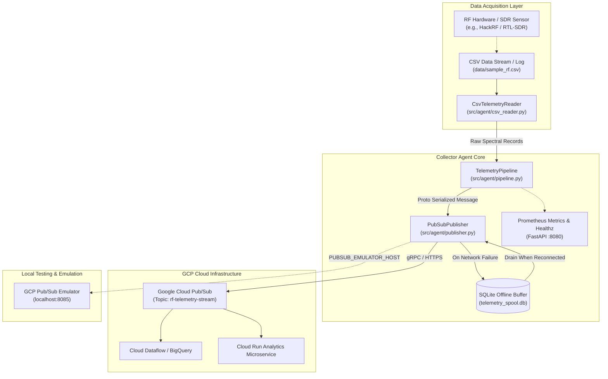
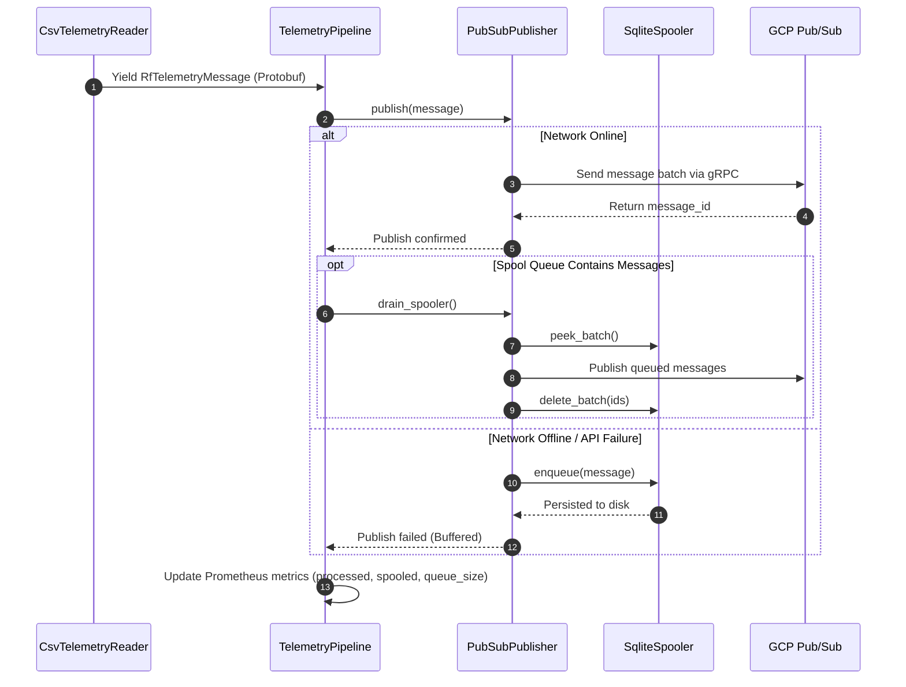
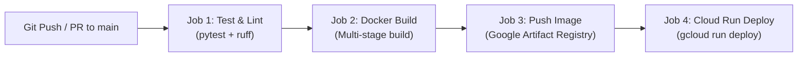

# GCP RF Telemetry Collector Agent

[](.github/workflows/deploy.yml)
[](https://www.python.org/)
[](LICENSE)

An IoT/Edge data collector agent designed to capture Radio Frequency (RF) spectral sweep telemetry from local sensors, Software Defined Radios (such as HackRF), or simulated CSV data streams. Telemetry is serialized using Protocol Buffers (`protobuf`) and streamed reliably to Google Cloud Platform (GCP) Cloud Pub/Sub and Cloud Run services with zero data loss during network disruptions.

---

## Architecture & System Design

### 1. End-to-End System Topology



### 2. Telemetry Processing & Offline Resilience Workflow

The agent guarantees resilience across unreliable edge network connections through persistent SQLite spooling and automated queue draining:



### 3. CI/CD Deployment Pipeline



---

## Key Features

- **Protocol Buffers Encoding:** High-efficiency binary serialization using `telemetry.proto` for low-latency transmission of high-density spectral power bins.
- **Dynamic Spectral Sweeps:** Robust CSV parsing handling variable-width power spectral density (`dB`) columns and duplicate header labels typical of sweep tools like `hackrf_sweep`.
- **Zero Data Loss Guarantee:** Persistent SQLite disk queue (`telemetry_spool.db`) buffers readings during network dropouts and automatically drains when connectivity resumes.
- **Flexible GCP Transports:** Supports direct Google Cloud Pub/Sub, local Google Cloud SDK Pub/Sub emulator (`PUBSUB_EMULATOR_HOST`), and pure offline mock mode.
- **Observability Built-in:** Lightweight FastAPI server providing `/healthz` for Kubernetes/Docker/Cloud Run health probes and `/metrics` for Prometheus scraping.
- **Container Native:** Multi-stage `Dockerfile` and `docker-compose.yml` pre-configured for edge deployment or cloud hosting.
- **Automated CI/CD:** GitHub Actions pipeline configured for testing, linting, Artifact Registry publishing, and GCP Cloud Run deployments.

---

## Protobuf Telemetry Schema

The core telemetry schema is defined in [`proto/telemetry.proto`](proto/telemetry.proto):

| Field Number | Field Name | Type | Description |
|---|---|---|---|
| `1` | `device_id` | `string` | Unique identifier for sensor/collector node |
| `2` | `timestamp_iso` | `string` | ISO 8601 UTC timestamp (`YYYY-MM-DDTHH:MM:SSZ`) |
| `3` | `timestamp_epoch_ms` | `int64` | Milliseconds since Unix epoch |
| `4` | `hz_low` | `double` | Start frequency of sweep range in Hertz |
| `5` | `hz_high` | `double` | Stop frequency of sweep range in Hertz |
| `6` | `hz_bin_width` | `double` | Step width per frequency bin in Hertz |
| `7` | `num_samples` | `int32` | Total FFT samples collected |
| `8` | `db_bins` | `repeated float` | Power spectral density measurements in dB per bin |
| `9` | `metadata` | `map<string, string>` | Extensible key-value metadata (gain, antenna, etc.) |

---

## Project Structure

```
gcp_rf_telemetry/
├── .github/
│   └── workflows/
│       └── deploy.yml              # CI/CD: Test, build, push, deploy to Cloud Run
├── conductor/                      # Spec-Driven Development tracks & blueprints
├── data/
│   └── sample_rf.csv               # Default sample RF sweep dataset
├── proto/
│   └── telemetry.proto             # Protobuf schema definition
├── scripts/
│   └── compile_proto.py            # Protobuf-to-Python compilation script
├── src/
│   └── agent/
│       ├── __init__.py
│       ├── cli.py                  # CLI entrypoint & argument parsing
│       ├── csv_reader.py           # Spectral CSV ingestion & parsing
│       ├── pipeline.py             # Telemetry orchestration loop
│       ├── publisher.py            # GCP Pub/Sub & Mock transport
│       ├── server.py               # FastAPI /healthz & Prometheus /metrics
│       ├── spooler.py              # SQLite offline buffer queue
│       └── proto/
│           ├── __init__.py
│           └── telemetry_pb2.py    # Auto-generated Protobuf Python classes
├── tests/
│   ├── fixtures/
│   │   └── sample_rf.csv           # Test CSV fixture
│   ├── test_cli.py                 # CLI integration tests
│   ├── test_csv_reader.py          # CSV parser tests
│   ├── test_pipeline.py            # End-to-end pipeline & offline tests
│   ├── test_proto.py               # Protobuf serialization tests
│   ├── test_publisher.py           # Pub/Sub publisher & drain tests
│   ├── test_server.py              # Observability endpoint tests
│   └── test_spooler.py             # SQLite queue tests
├── docker-compose.yml              # Agent + Pub/Sub emulator orchestration
├── Dockerfile                      # Multi-stage production container image
├── pyproject.toml                  # Dependencies, build tools, & test configs
└── README.md                       # Project documentation
```

---

## Getting Started

### Prerequisites

- Python 3.11+
- Docker and Docker Compose (optional, for containerized execution)
- Google Cloud SDK (`gcloud`) if deploying or running against live GCP resources

### Installation

1. **Clone the repository:**
   ```bash
   git clone https://github.com/self/gcp_rf_telemetry.git
   cd gcp_rf_telemetry
   ```

2. **Create and activate a virtual environment:**
   ```bash
   python3 -m venv .venv
   source .venv/bin/activate
   ```

3. **Install dependencies:**
   ```bash
   pip install --upgrade pip setuptools wheel
   pip install -e ".[dev]" grpcio-tools
   ```

4. **Compile the Protobuf schema:**
   ```bash
   python scripts/compile_proto.py
   ```

---

## Running the Agent

### 1. Dry Run Mode
Validate and parse CSV telemetry records locally without streaming or starting the HTTP server:
```bash
python -m agent.cli --csv-file data/sample_rf.csv --dry-run
```

### 2. Mock Mode (Default)
Run the pipeline with simulated Pub/Sub publishing, local SQLite spooling, and the observability server:
```bash
python -m agent.cli --csv-file data/sample_rf.csv --mock-mode --port 8080
```
Visit `http://localhost:8080/healthz` or `http://localhost:8080/metrics` in your browser.

### 3. Live Google Cloud Pub/Sub
Stream real-time telemetry to an active GCP Pub/Sub topic using Application Default Credentials (ADC):
```bash
gcloud auth application-default login

python -m agent.cli \
  --project-id my-gcp-project \
  --topic-id rf-telemetry-stream \
  --csv-file data/sample_rf.csv \
  --interval-sec 0.5 \
  --loop-csv
```

---

## Docker & Local Emulation

### Run with Docker Compose (Agent + Pub/Sub Emulator)
Test the full integration locally without incurring cloud costs:
```bash
docker compose up --build
```
This boots:
- **`pubsub-emulator`** listening on `0.0.0.0:8085`
- **`telemetry-agent`** streaming data to the emulator while exposing `/healthz` and `/metrics` on `http://localhost:8080`

### Build and Run Standalone Docker Image
```bash
docker build -t gcp-rf-telemetry-agent:latest .

docker run -p 8080:8080 \
  -e GCP_PROJECT_ID=gcp-rf-telemetry \
  -e PUBSUB_TOPIC_ID=rf-telemetry-stream \
  gcp-rf-telemetry-agent:latest
```

---

## Configuration Reference

### Command Line Arguments

| Flag | Default | Description |
|---|---|---|
| `--csv-file` | `data/sample_rf.csv` | Path to RF sweep CSV data file |
| `--project-id` | `gcp-rf-telemetry` | GCP Project ID (reads `GCP_PROJECT_ID` env) |
| `--topic-id` | `rf-telemetry-stream` | GCP Pub/Sub Topic ID (reads `PUBSUB_TOPIC_ID` env) |
| `--spool-db` | `telemetry_spool.db` | Path to SQLite buffer database |
| `--mock-mode` | `True` | Run publisher in mock mode without GCP calls |
| `--dry-run` | `False` | Parse CSV and print output without publishing |
| `--loop-csv` | `False` | Continuously repeat CSV playback |
| `--interval-sec` | `1.0` | Pause duration between emitted telemetry readings |
| `--port` | `8080` | Port for `/healthz` and `/metrics` HTTP server |

### Environment Variables

| Variable | Description |
|---|---|
| `GCP_PROJECT_ID` | GCP Project ID |
| `PUBSUB_TOPIC_ID` | Target Pub/Sub Topic Name |
| `PUBSUB_EMULATOR_HOST` | Host and port of Pub/Sub Emulator (`localhost:8085`) |
| `GOOGLE_APPLICATION_CREDENTIALS` | Path to GCP Service Account JSON key |

---

## Observability & Health Probes

The built-in FastAPI server runs concurrently alongside the data pipeline:

- **`GET /healthz`**: Returns `200 OK` JSON response (`{"status": "ok", "service": "gcp-rf-telemetry-agent"}`) for container liveness and readiness checks.
- **`GET /metrics`**: Standard Prometheus text format endpoint tracking:
  - `telemetry_messages_processed_total`: Total count of telemetry records ingested and processed.
  - `telemetry_messages_spooled_total`: Total count of messages written to disk during network interruptions.
  - `telemetry_spool_queue_size`: Gauge representing the current number of pending items in `telemetry_spool.db`.

---

## Testing & Quality Assurance

Run the test suite with code coverage:
```bash
pytest --cov=agent --cov-report=term-missing
```

Run code formatting and linting checks:
```bash
ruff check .
```

---

## CI/CD Deployment

The GitHub Actions workflow (`.github/workflows/deploy.yml`) automates:
1. **Verification:** Runs `ruff` linting and `pytest` test suite with coverage enforcement.
2. **Build:** Compiles Protobuf schemas and builds the multi-stage Docker container.
3. **Registry:** Pushes versioned tags and `latest` images to Google Artifact Registry.
4. **Deploy:** Deploys the container to **GCP Cloud Run** with automatic revision management.

**Required GitHub Repository Secrets:**
- `GCP_PROJECT_ID`: Target Google Cloud Project ID.
- `GCP_SA_KEY`: Service account JSON key with permissions for Artifact Registry and Cloud Run.
